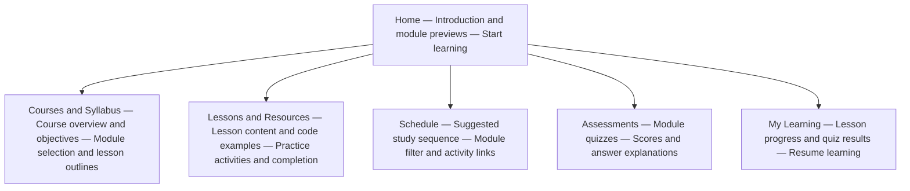

# E-learning Platform Sitemap Proposal

**Group Project Weeks 4–5 | 12 October 2026**

## Purpose and status

This sitemap describes a proposed page structure and how learners would move through the website. It is intended for group discussion alongside `planning.md`.

The group has agreed on an e-learning project and an initial planning board. **The six-page structure below is a proposal, not an agreed final design.** The example learning topic, Introductory Web Development, is also a proposal. Technology and individual responsibilities remain subject to group agreement.

## Pages and learning content are different

This proposal contains **six website pages: Home plus five feature pages**.

The example course contains three learning modules: **HTML Basics, CSS Basics and JavaScript Basics**. These modules are content displayed within the pages; they are not three additional pages.

For example, the Lessons and Resources page displays whichever lesson the learner selects. The Assessments page displays whichever module quiz the learner selects. Separate main pages are not needed for every lesson or quiz.

## Visual sitemap

The diagram shows the proposed Home page and five feature pages. The items listed inside each box are content or controls within that page, not additional pages. All six pages remain accessible through the shared navigation.

GitHub renders this Mermaid diagram in the Markdown preview. An editor displaying raw Markdown may show the diagram code instead.

## Proposed sitemap

All six pages are available through the shared navigation. The table lists their purpose and the main contextual links within each page.

| Page | Purpose | Main links within the page |
| --- | --- | --- |
| Home | Introduce the platform, intended learners and learning topics. | **Start learning** opens Courses and Syllabus. |
| Courses and Syllabus | Explain the course, module objectives, prerequisites, lesson outlines and assessment information. | **Begin module** opens its first lesson on Lessons and Resources. |
| Lessons and Resources | Display a selected lesson, explanations, code examples, practice instructions and resource links. Allow the learner to mark a lesson complete. | **Next lesson** changes the selected lesson. **Take module quiz** opens the matching quiz on Assessments. |
| Schedule | Show a suggested sequence for studying lessons, doing exercises and taking quizzes. This is a self-paced study guide, not a booking or attendance system. | **Open lesson** goes to the selected lesson. **Take quiz** goes to the selected assessment. |
| Assessments | Display the selected module quiz, allow submission, and show a score and answer explanations. | **Review lessons** opens the relevant module on Lessons and Resources. **View my progress** opens My Learning. **Retry quiz** restarts the selected quiz. |
| My Learning | Show completed lessons, lesson completion percentage and latest quiz results. | **Resume learning** opens the last viewed lesson. **Start learning** opens the first lesson when no history exists. Quiz links open the selected quiz on Assessments. |

“Courses and Syllabus” is a proposed page label. Although the label uses “Courses”, the proposed initial version contains only one course with three modules. The group may prefer “Course and Syllabus”.

## Shared navigation

Every page uses the same header, navigation and footer.

The proposed navigation order is:

1. Home
2. Courses and Syllabus
3. Lessons and Resources
4. Schedule
5. Assessments
6. My Learning

On desktop, the links can appear in a horizontal navigation bar. On mobile, they can appear in an expandable menu. The current page should be clearly indicated, and navigation should work with a keyboard as well as touch or mouse.

The platform name or logo links to Home. The footer should remain simple and consistent across pages.

## Example learner journeys

### First visit

1. Open Home and select **Start learning**.
2. Read the course overview on Courses and Syllabus.
3. Select **HTML Basics** and begin its first lesson.
4. Read the lesson, practise and select **Mark complete**.
5. Continue to the next lesson and take the HTML quiz.
6. Open My Learning to view lesson completion and the quiz result.

### Returning learner

1. Open My Learning through the shared navigation.
2. Select **Resume learning** to reopen the last viewed lesson.
3. Continue studying or retry a module quiz.

Under the proposed browser-storage approach, progress is available only in the same browser profile on the same website. It does not sync across devices or identify individual students.

### Learner following the study guide

1. Open Schedule.
2. Filter activities by module if desired.
3. Open a suggested lesson or quiz.
4. Return to Schedule through the shared navigation.

## Navigation behaviour to agree

- Links to learning content should preserve the selected module, lesson or quiz. For example, starting the CSS module should open a CSS lesson, not the first HTML lesson.
- If Lessons is opened directly from navigation, show a lesson selector and a clear starting lesson.
- If Assessments is opened directly, let the learner choose a module quiz.
- On a first visit, My Learning shows zero completed lessons, no quiz results and a **Start learning** action.
- Marking a lesson complete updates progress; it does not automatically submit a quiz or move to another page.
- The final navigation implementation should support browser Back and Forward, page refreshes and shared links on the selected hosting platform.

## Ideas from the initial board that need a group decision

The initial board includes registration and login, students, instructors, an administrator, guests, videos and a login/demo page.

This proposed six-page structure focuses on learners and guests entering through Home. It does **not** include separate registration, login, instructor or administrator pages. This is a proposed scope reduction to keep the first version manageable, and the group must agree before those features are postponed.

Videos could be included within Lessons and Resources rather than on a separate page. The group should decide whether to include them in the first version.

If the group retains account management or role-specific tools, revise this sitemap to include the required pages and links before implementation.

## Next step

Discuss and agree on the page structure and labels. Then create desktop and mobile wireframes showing the layout, content and controls for each page. Responsibilities can be assigned separately by the group.
